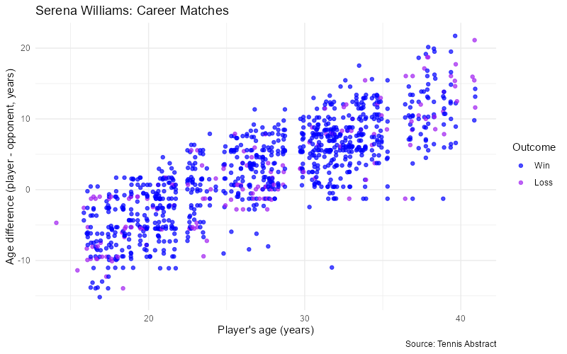
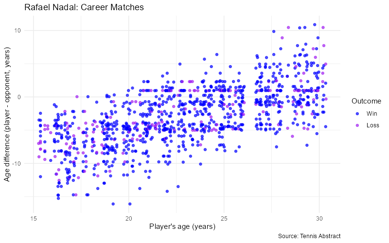

# tenniscareer

`tenniscareer` is an R package that downloads a professional tennis player's
career matches from [Tennis Abstract](https://www.tennisabstract.com/) and
plots how the player's age compared with their opponents' ages over the
course of their career. The plot follows the style of the New York Times
graphic of Serena Williams's opponents, without the annotations.

## What it does

- Accepts a player's name in a flexible format (`"serena williams"`,
  `"Serena Williams"`, `"SerenaWilliams"`).
- Downloads the player's career file (`<Player>Career.js`) and their date of
  birth from their Tennis Abstract profile page.
- Parses the JavaScript match array and handles both file formats:
  - **Women's files** list each opponent's date of birth, so the opponent's
    age is computed from it and the match date.
  - **Men's files** already list the opponent's age, which is used directly.
- Returns a clean data frame with one row per played match, including the
  player's age, the opponent's age, the age difference, and the outcome.
- Draws a scatter plot of age difference against age, coloured by wins and
  losses, as a `ggplot` object you can customise or save.

## Installation

Install the development version from GitHub with either:

```r
# install.packages("devtools")
devtools::install_github("UCB-stat159-f26/hw03-2-kassemlim")

# or
# install.packages("pak")
pak::pak("UCB-stat159-f26/hw03-2-kassemlim")
```

The package depends on `curl`, `ggplot2`, and `jsonlite`, which are
installed automatically.

## Functions

### `get_player_career(player_name)`

Retrieves and processes a player's career data. It returns a data frame
sorted by date with these columns:

| Column         | Description                                              |
|----------------|----------------------------------------------------------|
| `player`       | Player's full name                                       |
| `match_date`   | Tournament start date (`Date`)                           |
| `tournament`, `surface`, `round`, `opponent`, `score` | Match details     |
| `result`       | Factor: `"Win"` or `"Loss"`                              |
| `player_age`   | Player's age in years at the match                       |
| `opponent_age` | Opponent's age in years at the match                     |
| `age_diff`     | `player_age - opponent_age` (positive = player older)    |

Walkovers, defaults, and matches with a missing or invalid date, result, or
age are dropped. If Tennis Abstract has no career file for the name given,
the function stops with an error explaining what was looked for.

### `plot_player_career(career)`

Takes the data frame from `get_player_career()` and returns a `ggplot`
scatter plot:

- **x-axis:** the player's age
- **y-axis:** the age difference (player minus opponent)
- **colour:** blue for wins, purple for losses

## Examples

### Serena Williams

```r
library(tenniscareer)

serena <- get_player_career("serena williams")
head(serena[, c("match_date", "opponent", "result",
                "player_age", "opponent_age", "age_diff")], 3)
#>   match_date                 opponent result player_age opponent_age   age_diff
#> 1 1995-10-30              Anne Miller   Loss   14.09172     18.77618  -4.684463
#> 2 1997-03-07 Alexia Dechaume Balleret   Loss   15.44422     26.84463 -11.400411
#> 3 1997-08-04              Magui Serna   Loss   15.85489     18.42847  -2.573580

plot_player_career(serena)
```



### Rafael Nadal

```r
rafa <- get_player_career("Rafael Nadal")
plot_player_career(rafa)
```



### Customising and saving a plot

Because the plot is a regular `ggplot` object, you can add layers or save it:

```r
p <- plot_player_career(rafa) +
  ggplot2::labs(subtitle = "Each point is one match")
ggplot2::ggsave("rafael-nadal.png", p, width = 8, height = 5)
```

### Invalid player names

```r
get_player_career("GastonSanchez")
#> Error: No Tennis Abstract career data found for "GastonSanchez" (looked for
#> https://www.tennisabstract.com/jsmatches/GastonSanchezCareer.js). Check the
#> spelling and separate first and last names with a space, e.g. "Serena Williams".
```

## Notes and limitations

- Tennis Abstract records the tournament start date rather than the exact
  day of each match, so ages are approximate to within about two weeks.
- The package reads each player's `Career.js` file. For some players this
  file does not cover their most recent seasons (for example, Rafael Nadal's
  file currently ends in October 2016).
- Names typed without spaces are used as given apart from capitalising the
  first letter, so `"SerenaWilliams"` works but `"serenawilliams"` does not.
  Separating first and last names with a space is the most reliable format.
- Tennis Abstract may briefly limit repeated requests (HTTP 429); waiting a
  minute and trying again resolves this.

## Testing

The test suite runs entirely offline. Network access is blocked during tests,
and the download step is replaced by a mock that serves small career files
stored in `inst/extdata/` (`FemalePlayerCareer.js` and `MalePlayerCareer.js`).

```r
testthat::test_local()
```

## Personal Reflections

<!-- Replace this section with your own reflections. Some prompts you might
     respond to:
     - What was it like turning the earlier analysis scripts into a package?
     - What did you find tricky about the differences between the women's
       and men's data files?
     - How did writing offline tests change how you structured the code?
     - What would you add or do differently next time? -->

_To be written._
